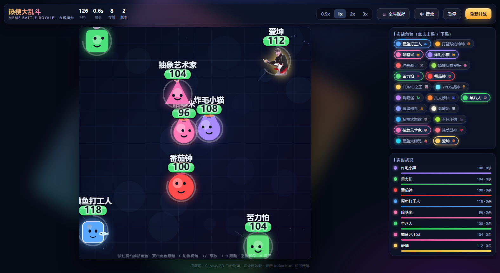
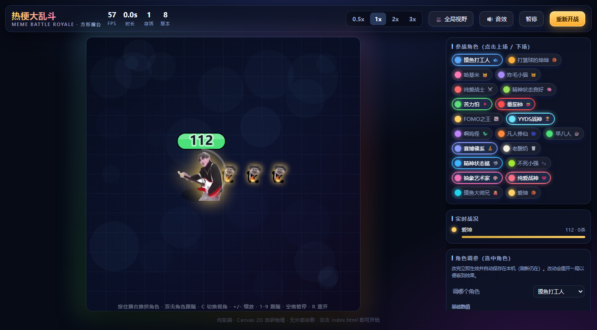
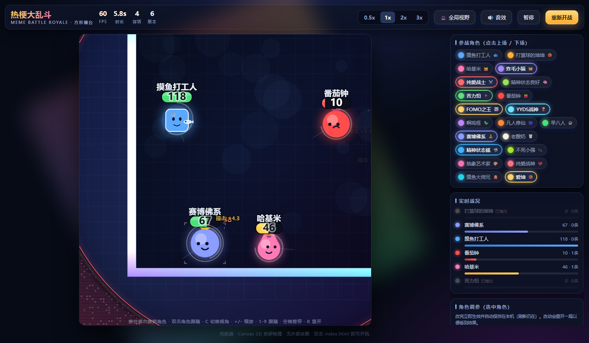
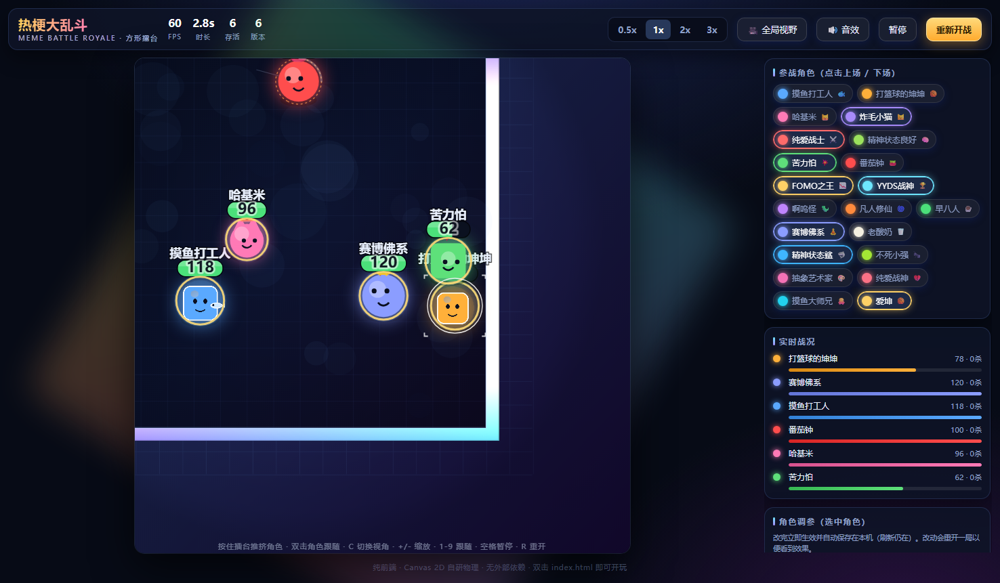
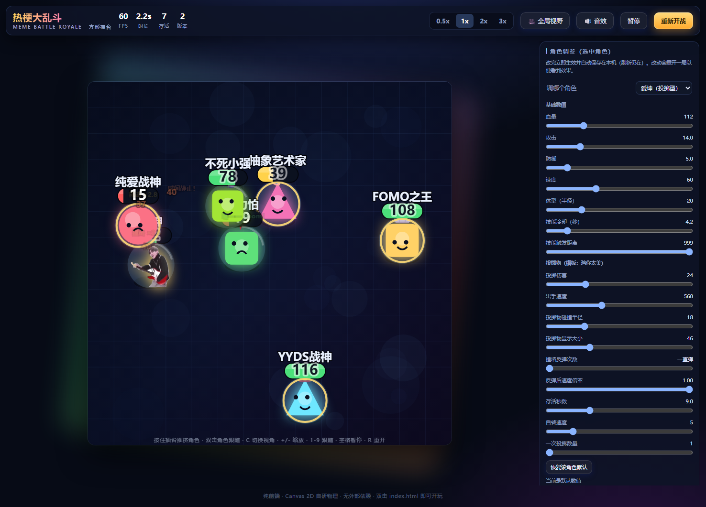

# 热梗大乱斗 · 方形擂台

一个纯前端的「方形擂台自动混战」模拟游戏。划定一个正方形擂台，让一堆网络热梗角色带着初始动量冲进去，
在墙壁和彼此之间不停碰撞，撞得越狠掉血越多，最后活下来的就是冠军。

**双击 `index.html` 就能玩**，不需要装任何东西、不需要起服务器、没有任何外部依赖。



---

## 一、怎么玩

| 操作 | 说明 |
|---|---|
| 点顶部角色标签 | 让角色上场 / 下场（至少保留 2 个） |
| 按住擂台拖动 | 像「上帝之手」一样推挤角色，改变战局 |
| **双击角色** | **跟随这个角色**（双击空白处回到全局） |
| **C** | **切换 全局视野 / 跟随视角** |
| **+ / -** | **调整跟随缩放**（会自动切到跟随视角） |
| **1-9** | **快速跟随第 N 个存活角色** |
| 空格 | 暂停 / 继续 |
| R | 重新开一局 |
| M | 静音 / 取消静音 |
| 0.5x / 1x / 2x / 3x | 比赛倍速 |

右侧能调 **移动模式**、**摄像机**、**伤害飘字**、**角色/血条大小**、**缩圈速度**、**角色智商**、**伤害倍率**、**自动重开**，
以及 **战场主题 / 背景图片**。
角色头顶的环是技能冷却：灰环在转 = 冷却中，金环 = 技能已就绪。

### 角色与血条尺寸

默认角色和血条都是 **2 倍**大小，右侧可实时调：

| 控件 | 说明 |
|---|---|
| **角色大小** | 0.5× ~ 4×，拖动即时生效（不用重开一局） |
| **血条大小** | 0.5× ~ 4×，独立于角色大小 |
| **血条内显示血量** | 开关血量数值 |

**血条内会显示剩余血量**（如 `62`，只显示当前值，不写成 `62/104`）。
数值做了对比度处理：

- 绿/黄底（血量 > 28%）→ **深色字 + 白色描边**
- 红底（残血）→ **白色字 + 深色描边**

这样三种血条底色上都看得清。侧栏「实时战况」同理，只显示当前血量与击杀数。

配置在 `data/config.js`：

```js
display: {
  unitScale: 2.0,        // 角色放大倍数
  hpBarScale: 2.0,       // 血条放大倍数
  hpBarShowValue: true,  // 血条内显示当前血量
  hpBarMinWidth: 46,     // 血条最小宽度
  hpBarFontSize: 12,     // 数值字号
  hpBarThickness: 11     // 血条厚度基准
}
```

> 说明：`unitScale` **同时放大碰撞半径**，所以「看到多大就撞多大」，不会出现视觉与判定错位。
> 放大后碰撞更频繁、比赛节奏会变快，属正常现象。

### 两种视角（自由切换）

- **全局视野**：看到整个擂台，适合看全场混战。
- **跟随视角**：镜头锁定某个角色跟随。**缩放在网页内随时可调**（见下）。

#### 缩放可以在网页里调

切到「跟随角色」后，右侧「战场设置」会多出几个控件：

| 控件 | 说明 |
|---|---|
| **跟随缩放**（滑块） | **0.5× ~ 3×**，拖动即时生效，右侧实时显示倍数 |
| **一键预设** | `0.6×` 远景 / `0.8×` 默认 / `1×` 全景 / `1.5×` 标准 / `2.2×` 特写 |
| **贴边留白** | 角色贴墙时镜头越界的余量：紧贴边界 / 标准 / 宽松 / 很宽松 |

**默认 0.8×**：略小于 1，既跟得住角色又留出周围视野，比 1.5× 更容易看清"谁要撞过来"。
**小于 1× 可以拉远**，此时整个擂台（连同外层背景）完整显示在画面里，适合看全局态势。
大于 1× 是特写，看得清角色动作。

三种调整方式，怎么顺手怎么来：

1. **拖滑块** —— 最直观
2. **按 `+` / `-`** —— 每次 0.05×，会自动切到跟随视角
3. **点倍率数字** —— 一键恢复默认值（回到出厂的 0.8×，而不是你上次调的值）

> **缩放、贴边留白、视角模式都会自动记住**，刷新后仍在（见「设置会自动保存」）。
> 滑块范围来自 `config.js` 的 `camera.zoomMin / zoomMax / zoomStep`，改配置就能改界面可选区间。

跟随模式的两条设计原则：

1. **缩放全程恒定** —— 跟随期间不做任何动态缩放。
   缩放忽大忽小是晕眩的主要来源，所以一旦设定就绝不变化（你调多少就是多少）。
2. **贴边时不再硬跟** —— 镜头只在擂台范围内平移。
   角色贴近墙边时镜头被边界挡住、不再硬跟，于是角色自然**偏离画面中心**，
   而镜头相对角色**更靠近地图中心**。实测：居中时镜头与角色重合（偏移 0px），
   贴左墙时角色偏离中心 182px、镜头停在 x=204 而角色在 x=21。
   这样既跟住了角色，又保留更多全局视野（能看到另一侧的战场）。

摄像机还做了这些处理：

- **速度前瞻**：按角色速度提前偏移镜头，快速移动时不会冲出画面
- **边界余量**：`edgePadding` 允许镜头少量越界（默认 40px），角色不至于贴死在屏幕边
- **指数平滑**：帧率无关的平移，不抖动
- **自动接管**：跟随目标阵亡后，自动切到下一个存活角色
- **取景框标记**：被跟随的角色有相机取景框式的四角标记

### 伤害飘字

碰撞/技能/毒圈伤害都会飘出数字，按来源着色：

| 来源 | 颜色 |
|---|---|
| 碰撞伤害 | 金色 `#ffd25e` |
| 技能伤害 | 淡蓝 `#9fd8ff` |
| 重击（速度倍率 > 1.35） | 橙色 `#ff8a5c` + 放大字号 |
| 毒圈伤害 | 白色（累计 4 点才飘一次，避免每帧刷屏） |

数字会弹出、上浮、淡出；同屏有 40 条上限，超出丢弃最旧的。可在设置里开关。

---

### 核心玩法：碰撞弹跳

角色**不再主动走位**，而是带着初速度在擂台里横冲直撞：

- **撞墙**：完全弹性反弹，速度不损失（`wallRestitution = 1`）
- **角色互撞**：按质量交换动量，默认接近**完全非弹性**（`unitRestitution = 0.15`）——
  撞在一起后动量合并、能量耗散，重的能把轻的顶飞
- **接触伤害**：碰撞时按**冲击速度**结算伤害。每个角色有独立的 `contact` 字段，
  **有的角色很扎人（纯爱战士 16 点），有的撞了完全不痛（老酸奶 `type: "none"`）**
- 质量默认按半径算（`massFrom: "radius"`），可以切 `hp` 或 `uniform`

实测伤害来源：**接触伤害 ~88%**、技能伤害 ~11%、毒圈 ~1% —— 碰撞是绝对主力。

#### 巡航速度：保持匀速直线运动

每个单位有一个**巡航速度**（`cruiseSpeed`，开局按 `spd` 定），每帧把实际速度
**温和地拉回**「巡航速度 × 状态倍率」：

```
速度在巡航的 ±16% 内 → 不干预（保留碰撞带来的自然波动）
超出范围            → 按指数逼近拉回，恢复越快越接近匀速直线
```

这样做的原因：碰撞和减速技能会不断改变速度，如果没有恢复项，
速度会被一点点磨掉，**后期角色越来越慢、场面停滞**。
现在减速技能只是临时压低速度倍率，**效果一结束速度就自己回到巡航值**。

撞墙时会按当前速度**向上刷新**巡航值（打得越猛之后跑得越快），
且**真的只升不降** —— 否则碰撞持续压低速度会把巡航基准一起拖下去。

> **修过的坑**：这里原本留了一个"略低候选值做 3% 向下修正"的分支，
> 注释写着"保持基准稳定"，实际是个**棘轮**：反复低速撞墙会把基准一路拖低。
> 实测反复以 200px/s 撞墙 40 次，巡航基准从 500 掉到 267 —— 这就是
> "玩着玩着角色就变慢"的直接来源之一。现在低候选值直接忽略。
> 回归测试见 `tools/verify-speed.js`。

配置在 `data/config.js`：

```js
movement: {
  cruise: {
    enabled: true,
    recovery: 2.4,        // 每秒朝巡航值靠拢的比例
    corridor: 0.16,       // ±16% 内不干预
    refreshOnBounce: 0.85,// 碰墙后向上刷新巡航值（只升不降）
    minCruise: 150,
    maxCruise: 900,

    /* 残局提速：存活越少，巡航基准越高 */
    endgameBoost: {
      enabled: true,
      tiers: [
        { maxAlive: 2, mul: 2.0 },
        { maxAlive: 3, mul: 1.6 },
        { maxAlive: 5, mul: 1.25 }
      ]
    }
  }
}
```

### 残局为什么墨迹，以及怎么治的

用户反馈"后期决胜很墨迹"。逐帧埋点（`tools/diag-speed.js` / `diag-endgame.js`）量出来：

- 整局约 **60% 的时间耗在"只剩 ≤3 人"**，其中 1v1 独占约一半；
- 但 1v1 期间两人**贴在一起的时间占比只有 0%**，**35% 的时间相距 400px 以上**；
- 平均 6~11 秒才撞上一次 —— **他们只是不碰面，不是速度慢**。

所以光提速治标不治本，真正有效的是**加速缩圈把人逼到中间**。
两项一起上（60 局实测）：

| 指标 | 修复前 | 修复后 |
|---|---|---|
| 整局平均 | 19.4s | **15.9s** |
| P90（最慢的一成） | 45.8s | **25.2s** |
| 1v1 平均时长 | 9.2s | **6.4s** |
| 毒圈致死占比 | 0.7% | 0.6%（仍以碰撞为主，不会变成"毒死"） |

```js
// data/config.js
arena: {
  endgameShrink: {          // 残局加速缩圈
    enabled: true,
    tiers: [
      { maxAlive: 2, mul: 2.0 },
      { maxAlive: 3, mul: 2.0 },
      { maxAlive: 5, mul: 1.3 }
    ]
  }
}
```

两项都只是**乘在计算里**，不写回 `world.shrink` / `u.cruiseSpeed`
（那分别是用户设置和基准值，写回会互相叠加、越滚越大），
把 `enabled` 设为 `false` 即可完全关闭、回到原来的节奏。

> **另一个修掉的坑**：分身（`isClone`）以前没继承本体的巡航速度，
> `cruiseSpeed = 0` 会退回到全局 `minSpeed`，只有本体一半左右的基准，
> 残局里等于拖着不走。现在技能生成分身时显式继承，`makeUnit` 也加了兜底。

擂台外有红色毒圈，安全区不断缩小，逼所有人往中间挤。最后存活者获胜，超时按「血量 + 击杀」判定冠军。

### 结算画面

结束时画布会压暗并打出结算横幅，两种结局都有明确提示：

| 结局 | 画面 |
|---|---|
| 有人胜出 | 金色横幅：冠军名字 + 🏆 冠军 + 击杀/输出 |
| **无人胜出** | 中性冷色横幅：**无人胜出** + ⚔️ 全员阵亡 + 平局 · 无人生还 |

"无人胜出"指**全员阵亡**（比如两人同归于尽），这是合法结局。
两种情况除了画布横幅，还会在屏幕上弹一次大字提示（冠军报名字，平局报"无人胜出"）。

> **修过的坑**：`drawResult` 以前在 `!winner` 时直接 `return`，
> 只留下那层压暗的遮罩 —— 屏幕上"只是变暗了"，一个字都没有，看起来像卡住了。
> UI 层的弹幕也要求 `winner` 非空，于是平局时完全没有提示。
> 现在两条路径都会渲染横幅，回归测试见 `tools/verify-art.js` 第 5b 节。

### 投射物（扔出去的东西）

`w.projectiles.push({...})` 可以发射投射物，**支持撞墙反弹**：

```js
w.projectiles.push({
  x: u.x, y: u.y, vx: 500, vy: 0,   // 位置与速度
  r: 18, dmg: 24 * w.dmgMul,        // 碰撞半径与伤害
  life: 9,                          // 存活秒数（兜底，防止无限游荡）
  owner: u,                         // ★ 归属者
  color: "#ffd166", spin: 5,        // 颜色 / 自转速度
  bounce: Infinity,                 // ★ 撞墙反弹次数，Infinity = 一直弹
  bounceDamp: 1,                    // 每次反弹的速度倍率（默认 1 不损失）
  img: skillImg, drawSize: 46,      // 用贴图当外观（动图会自己播）
  onBounce: function (p, w) {},     // 反弹回调（可选）
  onHit:    function (p, w) {}      // 命中/到期回调（可选）
});
```

**自伤保护是引擎负责的**：投射物永远不会命中 `owner` 自己，
也不会命中 `owner` 召唤出来的单位（分身互扔也不会误伤）。
不写 `bounce` 的投射物保持旧行为：出界即消失。

现成例子：**爱坤**（`id: "ikun"`）的「鸡你太美」——
扔出的球会一直撞墙反弹，直到砸到人为止。素材在
`assets/characters/ikun/`（`idle.webp` / `skill.webp` / `sfx/attack.mp3`）。
回归测试见 `tools/verify-projectile.js`。



> 想对比旧玩法？把「移动模式」切回 **主动追击** 即可（两套逻辑都保留）。

---

## 二、缩圈与圈外滤镜

右侧「缩圈 / 圈外滤镜」卡片可以实时调，全部即时生效：

| 控件 | 说明 |
|---|---|
| **安全区机制** | `开` 缩圈 + 圈外伤害 + 特效 / `关` **完全关闭，退化成纯擂台混战** |
| **圈外滤镜** | 总开关，关掉后圈外不变色 |
| **圈外透明度** | 毒区浓度 0 ~ 90% |
| **圈外主色 / 次色** | 取色器直接选颜色 |
| **由内向外渐变** | 开 = 越靠外越浓；关 = 纯色平铺 |
| **扫描线** + 强度 | 横向条纹纹理，营造"毒气"感 |
| **噪点颗粒** + 强度 | 静态颗粒（用格子哈希，**不会每帧闪烁**） |
| **边缘柔化** | 边界内侧渐隐宽度，避免生硬 |
| **脉动强度** | 呼吸式浓度变化 |

**安全区边界线**单独一组：显示开关 / 线宽 / 线透明度 / 发光强度。

### 关闭安全区 = 完全关掉

把「安全区机制」切到 **关** 时：

- 不缩圈（安全区半径固定为覆盖全擂台）
- **没有圈外伤害**
- **圈外滤镜与边界线完全消失**

一个控件关掉整套机制，不用逐个去调。同时整组控件的会变灰禁用，
缩圈速度下拉也会禁用，避免误操作。配置里对应 `arena.zoneEnabled`。

> 只想保留边界但不想掉血？把 `arena.poisonBase` 和 `arena.poisonRamp` 设为 0 即可，
> 特效仍会保留。

配置在 `data/config.js`：

```js
arena: {
  zoneEnabled: true,        // ★ 安全区总开关（false = 完全关闭）
  poisonFx: {
    enabled: true, color: "#ff3c50", color2: "#7a0b28",
    opacity: 0.16,          // 圈外透明度
    gradient: true,         // 由内向外渐变
    scanlines: true, scanOpacity: 0.30,
    noise: true, noiseOpacity: 0.22,
    blurEdges: 6,           // 边缘柔化（世界像素）
    pulse: 0.35
  },
  zoneRing: {
    enabled: true, color: "#ff5a6e",
    width: 2.5, opacity: 0.78, glow: 8, pulse: 0.22
  }
}
```




---

## 三、换背景

背景是**三层**结构，每层都能独立调 缩放 / 偏移 / 透明度 / 模糊：

```
┌───────────────────────────────────────────┐
│  外层 outer（铺满擂台之外的所有区域）        │
│   ┌─────────────────────────────────┐     │
│   │  边框 border（夹在内外之间的一条带）│    │
│   │   ┌───────────────────────┐      │     │
│   │   │  内层 inner（擂台方块）  │      │     │
│   │   │      角色在里面对战      │      │     │
│   │   └───────────────────────┘      │     │
│   └─────────────────────────────────┘     │
└───────────────────────────────────────────┘
```

- **外层**：擂台之外那一整片。镜头**缩小（<1×）**或贴边越界时看到的就是它，
  所以无论怎么移动镜头都**不会出现黑边**。
- **边框**：夹在内外之间的环带。`thickness`（边框厚度）**就是这一层显示的范围** ——
  设为 0 就完全不占空间。适合做发光灯带、警戒线、装饰描边。
- **内层**：正方形擂台本身。

### 右侧「三层背景」面板

用标签切换 外层 / 边框 / 内层，每层都能调：

| 参数 | 作用 |
|---|---|
| **图案**（外层 7 种） | 网格 / 点阵 / 同心圆 / 棋盘 / 斜线 / 十字 / 纯色 |
| **样式**（边框 5 种） | 发光 / 纯色 / 斜纹 / 虚线 / 网格 |
| **边框厚度** | 中间那层显示的范围（世界像素） |
| **纹理缩放** | 手动调节纹理对齐：花纹接缝错位时用它 |
| **水平/垂直偏移** | 同样用于纹理对齐 |
| **透明度** | 每一层独立 |
| **模糊** | 高斯模糊，可柔化贴图 |

> 还支持 **逐层换图**：切到某层 → 「给该层换图」（内层换的就是擂台图）。
> 「该层恢复默认」会同时清掉内存里的图片与 IndexedDB 存档（只重置配置是不够的）。
>
> 换图入口**只有这一处**。「战场设置」里原来还有一组「选择擂台图 / 恢复默认」，
> 与这里功能重复，已经删掉；「战场主题」下拉保留（它切换的是配色预设，不是重复功能）。

### 设置会自动保存（刷新不丢）

三层的**所有参数**（图案 / 样式 / 厚度 / 缩放 / 偏移 / 透明度 / 模糊 / 遮罩 / 暗角…）、
**当前主题**、三层的**自选图**，以及**摄像机（缩放 / 贴边留白 / 视角模式）**
和**显示尺寸（角色大小 / 血条大小 / 血条数值开关）**，
都会自动存在本机浏览器里，刷新或重开都还在。
连「双击 `index.html`」这种 `file://` 玩法也一样有效。

分两处存，各管一摊：

| 存什么 | 存哪里 | 为什么 |
|---|---|---|
| 各层参数 + 当前主题 + 摄像机 + 显示尺寸 | `localStorage` | 纯文本，小、读写快 |
| 三层的自选图片 | `IndexedDB`（Blob） | 图片是二进制，`localStorage` 塞不下 |

实现见 `src/settings.js`（参数）与 `src/background.js`（图片）。
几个刻意的设计：

- **不存 `src`**：界面选的图会生成 `blob:` 临时地址，刷新后必然失效。
  图片一律存成 Blob 进 `IndexedDB`，读回来再重新生成地址。
- **`settings.js` 必须排在 `background.js` 之前**：后者在自己的 IIFE 里就捕获了
  `CONFIG` 引用，存档要先合并进 `CONFIG` 才读得到（`engine.js` 同理，
  `World` 构造时会读 `camera.mode` 与 `display.unitScale`）。
- **滑块做了 250ms 防抖**：拖动过程中不写盘，停手才写，避免每像素一次 `localStorage` 写。
  刷新/切后台时会补写一次，所以「刚调完就刷新」也不会丢。
- **防抖定时器由 `settings.js` 持有**，而不是放在 `ui.js`。
  因为 `clear()` 必须能取消掉"还没触发的那次写入"：否则「恢复默认」刚清空存档，
  250ms 后待触发的定时器又把旧值写回去，刷新一下"默认"就没了。
- **「恢复默认」会连存档一起清掉**，否则刷新之后又变回上次的设置，看起来像没生效。
- **「恢复默认」取的是出厂快照**，不是当前 `CONFIG`（后者已混进存档）。
  否则点「恢复默认缩放」会回到"你上次调的值"，而不是真正的默认 0.8×。
- 隐私模式下 `localStorage` 不可用时只打一条提示，游戏照常玩，只是设置不跨刷新。

### 三种换内层图的方式（界面 / 上传 / 项目文件）

**① 界面直接换主题**：右侧「战场主题」里选 5 种预设配色之一，即时生效。

**② 上传自己的图**：在「三层背景」面板切到内层 → 「给该层换图」，
选 PNG / JPG / WEBP / GIF（≤ 12 MB）。图片会保存在浏览器本地，刷新后仍在。

**③ 作为项目默认背景**：把图片放进 `assets/backgrounds/`，然后在 `data/config.js` 写：

```js
render: {
  background: {
    /* 内层：擂台方块 */
    preset: "neon",
    src: "assets/backgrounds/arena.webp",
    fit: "cover",                         // cover / contain / stretch
    overlay: 0.40,                         // 暗色遮罩 0~1
    maxUploadBytes: 12582912,

    inner: {                              // 内层
      enabled: true, opacity: 1, scale: 1, offsetX: 0, offsetY: 0,
      blur: 0, vignette: 0.42
    },

    border: {                             // 边框层
      enabled: true,
      thickness: 26,                      // ★ 显示范围
      style: "glow",                      // glow/solid/stripes/dashes/grid
      src: "", fit: "stretch",
      color: "", color2: "",              // 留空 = 跟随主题
      opacity: 1, scale: 1, offsetX: 0, offsetY: 0, blur: 0,
      glow: 10, pulse: 0.35
    },

    outer: {                              // 外层
      preset: "auto", color: "", src: "", fit: "cover",
      pattern: "grid",                    // ★ 图案
      patternColor: "", patternScale: 46, patternWidth: 1.2,
      opacity: 1, overlay: 0.42,
      scale: 1, offsetX: 0, offsetY: 0, blur: 0,
      glow: true, margin: 0.6
    }
  }
}
```

这样一打开就是你的图，别人拿到项目也能直接看到。

> 细节见 [assets/backgrounds/README.md](assets/backgrounds/README.md)。
> 背景只影响视觉，不改变擂台碰撞和安全区逻辑。

---

## 四、目录结构

```
meme-arena/
├── index.html                  ← 双击这个开始玩
├── data/
│   ├── characters.js           ★ 角色数据（名字/数值/技能）都在这里，手改就改它
│   └── config.js                 全局参数（比赛时长、毒圈、手感、音量…）
├── src/
│   ├── utils.js                  工具函数 + 角色数据校验
│   ├── assets.js                 贴图 / 序列帧 / 音效的加载与回退
│   ├── settings.js               设置的本地持久化（localStorage，须在 background.js 之前加载）
│   ├── background.js             擂台主题与可替换背景图（三层 + IndexedDB 存图）
│   ├── engine.js                 战斗模拟：单位、物理、AI、伤害结算、特效
│   ├── render.js                 Canvas 渲染
│   ├── ui.js                     界面绑定与主循环
│   └── style.css                 界面样式
├── assets/
│   ├── manifest.js               ← 由扫描工具自动生成，别手改
│   ├── backgrounds/              背景图放这里（含 README）
│   └── characters/
│       ├── README.md             ★ 素材命名约定（放贴图前先看这个）
│       ├── moyu/                 每个角色一个文件夹，名字 = 角色 id
│       └── kunkun/ …
├── tools/
    ├── scan-assets.js            扫描素材文件夹 → 生成 manifest.js
    ├── make-demo-assets.py       生成一套演示素材（贴图/序列帧/音效）
    ├── sim-test.js               无头仿真回归测试（不开浏览器）
    ├── browser-check.js          真实浏览器端到端验证 + 截图
    ├── verify-art.js             专门验证贴图/序列帧/音效管线
    ├── verify-background.js      专门验证背景主题与图片替换
    ├── verify-persist.js         设置持久化：三层参数/图片 + 摄像机 + 显示尺寸跨刷新保留
    ├── verify-speed.js           速度系统：巡航只升不降 / 分身继承 / 残局提速与小场保护
    ├── verify-projectile.js      投射物：撞墙反弹 / 命中伤害 / 绝不误伤自己与分身
    ├── verify-tune.js            角色调参面板 / 投掷型模板 / 胜负音效
    ├── remove-bg.py              把纯色背景抠成透明（支持动图、棋盘格底纹）
    ├── diag-speed.js             诊断：按存活人数统计实际速度 vs 巡航速度
    ├── diag-endgame.js           诊断：残局时长与碰撞频率
    ├── diag-cruise.js            诊断：巡航基准是否被棘轮式拖低
    └── cdp.js                    无头浏览器控制封装
└── _verify/                    README 引用的验证截图
```

---

## 五、改角色（最常用）

打开 `data/characters.js`，找到想改的角色，直接改数值，**刷新页面就生效**：

```js
{
  id: "moyu",                    // 唯一标识，同时也是素材文件夹名
  name: "摸鱼打工人",             // 显示名
  icon: "🐟",                    // 没有贴图时头顶显示的 emoji
  color: "#5aa9ff",              // 主题色
  shape: "round",                // 没有贴图时的外形：round/square/tri/cat
  hp: 118, atk: 13, def: 6, spd: 46, radius: 21,
  skillName: "带薪摸鱼",
  cooldown: 5.4,                 // 技能冷却秒数
  skillRange: 999,               // 离目标多近才愿意放技能（999 = 随时放）
  skillDesc: "原地摸鱼回血，同时短暂免疫伤害。",
  contact: { damage: 8, type: "impact", desc: "摸鱼蹭一下" },  // ★ 接触伤害
  skill: function (u, w) {
    w.heal(u, 15 + u.stats.hp * 0.03);
    u.invuln = Math.max(u.invuln, 0.65);
    w.popText(u.x, u.y - 34, "带薪摸鱼 +血", "#7fd0ff");
  }
}
```

### `contact` 字段（碰撞时是否伤人）

| 字段 | 说明 |
|---|---|
| `damage` | 冲击速度达到 `referenceSpeed` 时的伤害基准值 |
| `type` | 伤害类型，纯展示用：`impact` / `blade` / `blast` / `spark` / `bite` / `none` |
| `desc` | 鼠标悬停角色时显示的一句话说明 |

**`type: "none"` 或 `damage: 0` = 碰到别人不掉血**（比如「精神状态良好」「老酸奶」「赛博佛系」）。
实际伤害会按冲击速度缩放：撞得越快越疼，`minImpactSpeed` 以下不算伤害。

想**加一个新角色**：复制文件里注释的那段模板，改掉 `id` 等字段，再去
`assets/characters/` 下建一个同名文件夹放素材即可。

技能能用的 API（`u` 是自己，`w` 是世界）都写在 `characters.js` 文件顶部注释里，包括
`w.damage()`、`w.heal()`、`w.popText()`、`w.explosion()`、`w.beam()`、`w.projectiles.push()` 等。

> 改错了也不怕：加载时会自动校验角色数据，问题会打到浏览器控制台（F12 查看）。
> 另外可以跑 `node tools/sim-test.js`，它会检查数据合法性并模拟几百局，确认没有报错。

### 现成的角色模板：`makeThrower`（扔东西型）

"撞上去 + 扔东西"这一类角色不用每次抄一遍 `skill`，用工厂函数生成就行：

```js
makeThrower({
  id: "ikun", name: "爱坤", icon: "🏀", color: "#ffd166",
  hp: 112, atk: 14, def: 5, spd: 60, radius: 20,
  skillName: "鸡你太美", cooldown: 4.2, skillDesc: "……",
  contact: { damage: 9, type: "impact", desc: "唱跳 rap" },
  throw: {              // ← 投掷物参数，网页里可以直接调
    dmg: 24,        // 命中伤害
    speed: 560,     // 出手速度
    size: 46,       // 贴图显示大小
    radius: 18,     // 碰撞半径
    bounce: -1,     // 撞墙反弹次数；-1 = 一直弹
    bounceDamp: 1,  // 每次反弹速度倍率（<1 会越弹越慢）
    life: 9,        // 存活秒数（兜底）
    spin: 5,        // 自转
    spread: 3,      // 一次扔几个（>1 扇形散开）
    aim: 1,         // 1 = 朝敌人扔（默认）；0 = 沿自己运动方向扔
    lead: 1         // 预判提前量：按目标速度提前瞄准（0 = 瞄当前位置）
  }
})
```

省略的字段会走默认值；`shape` 默认 `round`、`skillRange` 默认 `999`（随时可放）。
自伤保护由引擎负责，不用在模板里写。也可以直接在控制台试着造一个：

```js
MA.CHARACTERS.push(MA.makeThrower({ id: "test", name: "测试", icon: "🧪", color: "#8fd0ff" }))
```

#### 触发方式与投掷方向

- **按时间触发**：技能由 `cooldown` 计时器驱动，**跟碰撞完全无关**。
  实测单场 30 秒触发 7 次、平均间隔 4.59s（配置 4.2s），而且场上没有敌人时照常触发。
- **朝敌人扔**：默认瞄准当前锁定的目标（`aim: 1`），并按它的速度做**提前量预判**
  （`lead: 1`），否则球总是打在敌人"刚才"的位置，移动目标基本打不中。
  实测：自己向上跑、敌人在正右方时，投掷方向是 **0°（对准敌人）** 而不是 -90°（运动方向）。
- 把 `aim` 调成 0 就回到"沿自己运动方向扔"，`lead` 调成 0 则不预判。

> 早期版本沿"自己的运动方向"扔，所以经常打空、只有偶尔撞上才有反馈，
> 看起来像"要碰到才生效"—— 其实是方向问题，不是触发问题。

### 网页里直接调参：右侧「角色调参」

右侧新增了一栏 **角色调参**，选一个角色就能实时改数值，不用去动代码：

- **基础数值**：血量 / 攻击 / 防御 / 速度 / 体型 / 技能冷却 / 技能触发距离
- **投掷物**（选中投掷型角色时才会出现）：投掷伤害 / 出手速度 / 碰撞半径 /
  显示大小 / **撞墙反弹次数** / 反弹后速度倍率 / 存活秒数 / 自转速度 / 一次投掷数量 /
  **投掷瞄准**（瞄准敌人 ↔ 沿运动方向）/ **预判提前量**

改动**立即生效**（会自动重开一局，方便看到效果）并**自动保存在本机**，刷新后仍在；
点「恢复该角色默认」可以还原成出厂值。

> 实现上这些参数都存在角色模板的 `tpl.throw` 数据对象里，而不是写死在技能的闭包里 ——
> 所以面板才能实时改它们。自己写新技能时，把想暴露成"可调"的数值也放到模板上即可。
> 回归测试见 `tools/verify-tune.js`。



### 结算音效

比赛结束时会播一段音效，**胜负是两种不同的声音**：

| 结局 | 音效 |
|---|---|
| 有冠军 | 上行三音号角（`victory`），优先用获胜角色的 `sfx/victory.*`，没有就用内置合成音 |
| 无人胜出 | 下行两音（`draw`），用内置合成音 |

想给某个角色配专属胜利音，把文件放进它的 `sfx/` 目录命名成 `victory.mp3` 即可
（也认 `draw.*`）。跑一次 `node tools/scan-assets.js` 就会登记。

---

## 六、给角色换贴图 / 动图 / 音效

每个角色一个文件夹，**把文件按名字丢进去就行**，代码一行都不用改：

```
assets/characters/moyu/
├── idle.png         待机（必需，没有就用几何图形）
├── attack.png       出手瞬间（可选）
├── hurt.png         受击（可选）
├── dead.png         阵亡（可选）
├── icon.png         头像（可选）
├── skill.png        技能特效（可选）
└── sfx/
    ├── attack.wav
    ├── skill.wav
    ├── hurt.wav
    └── death.wav
```

丢完文件后跑一次扫描，让游戏知道有新素材：

```bash
node tools/scan-assets.js
```

然后刷新页面即可。扫描器还会提示**哪些文件命名没被识别**，避免"放进去了却没生效"。

### 三种动画做法，推荐程度从高到低

1. **序列帧（最推荐）**：放 `idle_01.png`、`idle_02.png` … 扫描器会自动识别成动画。
   由游戏循环驱动，帧率可控，能和攻击/受击动作精确同步，也能自动化测试。
2. **GIF 动图**：直接放 `idle.gif`，浏览器原生播放，最省事（但动画节奏不受游戏控制）。
3. **单张静态图**：只放 `idle.png`，最简单。

**所有素材都是可选的**，缺哪张就自动回退：`attack` → `idle` → `icon` → 代码画的几何图形。
音效缺失时自动用内置合成音兜底。所以你可以先只放一张图，后面再慢慢补。

> **⚠️ 图片必须带透明通道**：用 **PNG / WEBP**。
> JPG 没有 alpha 通道，透明区域会变成白底，角色就成了一个白色方块。
> 怎么抠图、怎么自检透明有没有丢，见
> [assets/characters/README.md](assets/characters/README.md#图片格式只有带透明通道的才不留白底)。

> 完整的命名约定、别名列表、素材规格建议见 [assets/characters/README.md](assets/characters/README.md)。
> 想先看看效果，可以跑 `python tools/make-demo-assets.py` 生成一套演示素材
> （会给"摸鱼打工人"生成静态图+音效，"打篮球的坤坤"生成 8 帧序列动画）；
> 不想要了就 `python tools/make-demo-assets.py --clean` 清掉。

---

## 七、全局参数

`data/config.js` 里能调比赛时长、毒圈收缩速度与伤害、攻防公式、移动手感、
粒子数量、音量、界面显示等。常用的几个：

| 参数 | 作用 |
|---|---|
| `movement.mode` | `momentum` 碰撞弹跳（默认）/ `active` 主动追击 |
| `movement.initialSpeed` | 开局初速度基准 |
| `movement.unitRestitution` | 角色间恢复系数：`0` 完全非弹性 / `1` 完全弹性 |
| `movement.wallRestitution` | 撞墙恢复系数：`1` = 完全弹性不掉速 |
| `movement.massFrom` | 质量来源：`radius` / `hp` / `uniform` |
| `movement.tangentialJitter` | 碰撞切向随机量，避免完全非弹性后黏成一团 |
| `movement.minSpeed` / `maxSpeed` | 速度下限（防静止）/ 上限（防飞出去） |
| `movement.contact.*` | 接触伤害标定：参考速度、冷却、伤害上下限、整体倍率 |
| `movement.cruise.*` | ★ 巡航速度模型：恢复速度 / 容差 / 撞墙刷新 / 上下限 |
| `movement.cruise.endgameBoost` | ★ 残局提速：按存活人数提高巡航基准（`minField` 保护小场） |
| `arena.endgameShrink` | ★ 残局加速缩圈：按存活人数加快收圈（`minField` 保护小场） |
| `camera.mode` | `global` 全局 / `follow` 跟随 |
| `camera.followZoom` | 跟随时的**固定**放大倍数（默认 0.8，网页内可调，支持 <1 拉远） |
| `camera.zoomMin` / `zoomMax` / `zoomStep` | 网页缩放滑块的范围与步进 |
| `background.inner.*` | 内层：透明度 / 缩放 / 偏移 / 模糊 / 暗角 |
| `background.border.*` | 边框层：**厚度** / 样式 / 发光 / 脉动 / 缩放 / 偏移 / 模糊 |
| `background.outer.*` | 外层：**图案** / 间距 / 线宽 / 缩放 / 偏移 / 模糊 / 遮罩 |
| `camera.edgePadding` | 贴边时允许镜头越界的余量（默认 40px），角色不至于贴死屏幕边 |
| `camera.smooth` / `leadFactor` | 跟随平滑度 / 速度前瞻比例 |
| `damageNumbers.enabled` | 伤害飘字开关 |
| `damageNumbers.maxOnScreen` / `life` | 同屏上限 / 存活秒数 |
| `match.timeLimit` | 超时判定秒数（默认 95） |
| `match.defaultPicks` | 首次进入随机上场几个人 |
| `arena.zoneEnabled` | ★ 安全区总开关（false = 完全不缩圈、无伤害、无特效） |
| `arena.shrinkRate` / `safeZoneStart` / `safeZoneMin` | 缩圈速度 / 初始半径 / 最小半径 |
| `arena.poisonBase` / `poisonRamp` | 圈外每秒伤害 / 随时间增长 |
| `arena.poisonFx.*` | 圈外滤镜：透明度 / 颜色 / 扫描线 / 噪点 / 柔边 / 脉动 |
| `arena.zoneRing.*` | 安全区边界线：线宽 / 透明度 / 发光 |
| `combat.defScale` | 防御减伤强度 |
| `audio.enabled` / `audio.volume` | 音效开关与音量 |
| `render.background.*` | 战场主题 / 背景图 / 三层结构 |
| `render.rosterUpdateHz` | 侧栏战况刷新频率（默认 10） |

---

## 八、验证与测试

改完东西想确认没搞坏，按顺序跑：

```bash
node tools/sim-test.js 200      # 1. 数据校验 + 200 局无头仿真（秒级完成）
node tools/scan-assets.js       # 2. 重新扫描素材
node tools/browser-check.js     # 3. 真实浏览器端到端验证（会截图到 _verify/）
node tools/verify-art.js        # 4. 素材管线验证（贴图/序列帧/音效）
node tools/verify-background.js # 5. 背景主题与图片替换验证
node tools/verify-camera.js     # 6. 摄像机 / 伤害飘字 / 帧率验证
node tools/verify-outer-bg.js   # 7. 无黑边验证（<1 缩放 / 贴边越界）
node tools/verify-layers.js     # 8. 三层背景（图案/厚度/缩放/透明度/模糊/层次顺序）
node tools/verify-zone.js       # 9. 缩圈开关 / 圈外滤镜 / 安全区边界线
node tools/verify-motion.js     # 10. 巡航速度模型 / 伤害飘字定位
node tools/verify-display.js    # 11. 角色放大 / 血条放大 / 血量数值
node tools/verify-persist.js    # 12. 设置持久化（三层设置 + 摄像机缩放 + 显示尺寸）
node tools/verify-speed.js      # 13. 速度系统（巡航基准不衰减 / 分身继承 / 残局提速）
node tools/verify-projectile.js # 14. 投射物（撞墙反弹 / 命中伤害 / 不误伤自己）
node tools/verify-tune.js       # 15. 角色调参面板 / 投掷型模板 / 胜负音效
```

`browser-check.js` 会检查：脚本加载、界面渲染、模拟推进、坐标不越界、
数值无 NaN、技能不抛异常、按钮与设置项生效，并把早/中/后期和结算画面截图到 `_verify/`。

> 这些浏览器测试会在结束时自动关闭无头浏览器，并带看门狗兜底，
> 即使中途被强制中断也不会留下后台进程占用 CPU。
> 每个脚本运行时间很短（10~40 秒），不会长时间占用资源。

---

## 九、实现说明

- **纯 Canvas 2D 手写渲染**，没有引入任何游戏引擎或第三方库。
- **移动**：两套模式。默认 **动量碰撞** —— 角色只有初速度，靠冲量与恢复系数演化，
  冲量公式 `j = -(1+e)·v_n / (1/m₁ + 1/m₂)`，位置修正按质量反比分配。
  完全非弹性碰撞会抹平法向速度，所以额外注入切向抖动，避免全场黏成一团后静止。
- **接触伤害**：按冲击速度缩放，带同一对角色的冷却，避免贴在一起每帧狂扣。
- **物理稳健性**：撞墙后短暂豁免「速度下限」补足，否则补足方向会把角色顶回墙里、
  破坏完全弹性反弹；技能生成分身/瞬移后统一夹回场内，防止露到场外。
- **AI（主动模式）**：周期性重新选目标（综合距离、残血程度、集火情况），
  维持理想交战距离、躲避毒圈、互相避让；技能按「冷却好了 + 距离合适」才释放。
- **伤害管线**：所有伤害都走统一的 `damage()` 入口，依次结算 护盾吸收 → 防御减伤 →
  无敌帧 → 反伤 → 击杀，保证 20 个角色的各种技能不会互相打架。
- **圈外滤镜**：用 `evenodd` 裁剪出"矩形减圆"的环带区域，
  依次叠加 底色/渐变 → 扫描线 → 噪点 → 边界柔化。
  噪点用**格子坐标哈希**而不是 `Math.random()` —— 颗粒因此是静态的、不会每帧闪烁
  （逐帧随机会让人眼不适，也让截图无法复现）。
- **素材系统**：约定式自动发现，全部可选、逐级回退，缺素材永远不会报错。
- **漂字坐标变换**：跟随视角下飘字要保持恒定屏幕大小，需要临时撤掉摄像机的「缩放」分量。
  当前 CTM 是 `T(A/2,A/2)·S(zoom)·T(-cam.x,-cam.y)`，追加
  `T(cam.x,cam.y)·S(1/zoom)·T(-cam.x,-cam.y)` 后中间两项抵消，只剩
  `T(A/2-cam.x, A/2-cam.y)`。
  **注意最后一步必须是 `T(-cam.x,-cam.y)`** —— 写成 `T(-A/2,-A/2)` 会化简成恒等变换，
  世界坐标被当成屏幕坐标，飘字就会跑到左上角。
- **背景系统**：三层结构（外 → 边框 → 内），每层一个离屏缓存。
  缓存键包含该层所有参数，所以调滑块只在变化时重建，正常帧只贴一次图。
  外层的图案锚定**世界原点**绘制，镜头移动时花纹不会"粘在屏幕上"；
  外层还按"当前可见世界矩形"实时铺满，保证镜头怎么动都不露黑底。
- **性能**：绘制限频、侧栏 DOM 限频更新、页签切到后台自动停帧，
  在低配机器和笔记本上都不会持续高占用。
- **帧率**：主循环只用 `requestAnimationFrame` 驱动。**不要和 `setTimeout` 混用限频** ——
  rAF 跟 vsync（16.7ms）走，再叠一个定时器会跨过下一个 vsync 边界，产生拍频锁死
  （表现为帧率卡在 40/30 不动）。暂停时才用定时器慢轮询。

角色均为网络流行梗的**戏仿**形象，用几何图形 + 文字绘制，不使用任何真人肖像或品牌素材。
如果你自己放入贴图，请确保拥有相应使用权。

---

## 十、许可

[MIT](LICENSE) © 2026 DGGK2333
